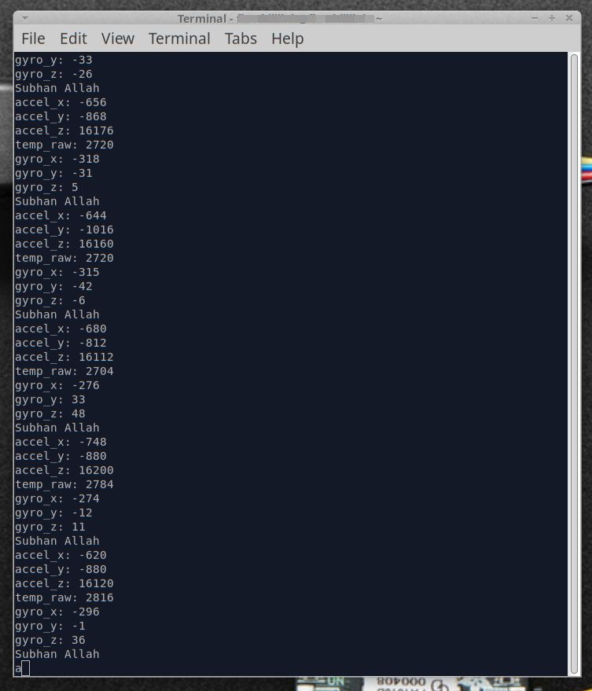
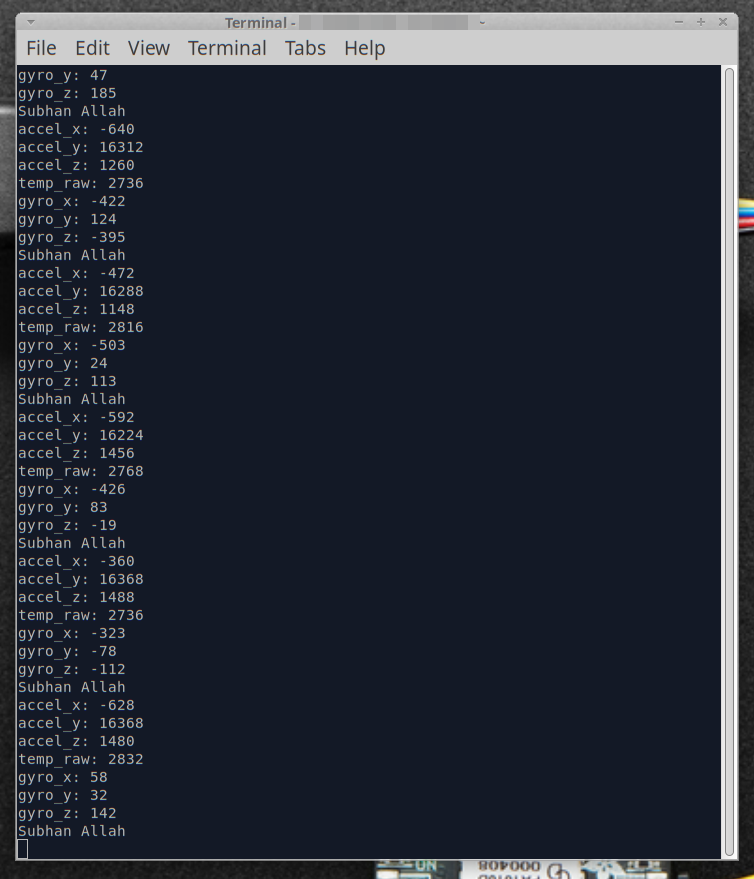
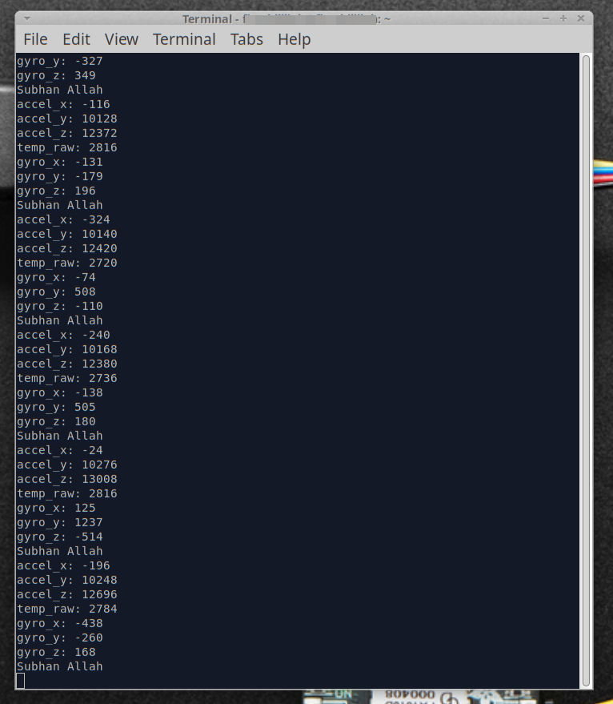

# Bare-Metal STM32F103 SPI Driver for MPU-6500 + USART1 Telemetry

Bare-metal C firmware for the STM32F103C8 (72 MHz) that reads 14 bytes of accelerometer, temperature, and gyroscope data from an MPU-6500 IMU over SPI1 and streams formatted text over USART1 at 115200 baud. Written directly against CMSIS device registers without HAL or LL libraries.

---

## Hardware Pinout

| STM32F103 Pin | Peripheral Function | MPU-6500 / USB-UART Pin | Notes |
| :--- | :--- | :--- | :--- |
| `PA4` | GPIO Output (Push-Pull, 50 MHz) | `NCS` (Chip Select) | Software-controlled CS (`GPIOA->BSRR`) |
| `PA5` | `SPI1_SCK` (AF Push-Pull) | `SCL` / `SCLK` | SPI clock at 1.125 MHz (`fPCLK / 64`) |
| `PA6` | `SPI1_MISO` (Input Floating) | `AD0` / `SDO` | Data from MPU-6500 to STM32 |
| `PA7` | `SPI1_MOSI` (AF Push-Pull) | `SDA` / `SDI` | Commands/data from STM32 to MPU-6500 |
| `PA9` | `USART1_TX` (AF Push-Pull) | USB-UART `RX` | 115200 baud, 8N1 |
| `PA10` | `USART1_RX` (Input Floating) | USB-UART `TX` | Optional RX line |
| `3.3V` / `GND` | Power | `VCC` / `GND` | Common ground required with USB-UART adapter |

---

## Register & Peripheral Setup

- **System Clock (`clock.c`):** Enables the external 8 MHz crystal (HSE), configures Flash prefetch with 2 wait states, sets PLL multiplier to x9 for a 72 MHz SYSCLK, and divides APB1 by 2 (36 MHz) while keeping APB2 at 72 MHz.
- **Timebase (`systick.c`):** Configures `SYST_RVR = 71999` for a 1 ms interrupt tick (`ms_ticks`) used for non-blocking delays (`delay_ms`).
- **SPI1 (`spi.c`):** Configured as Master (`MSTR`), software slave management (`SSM` + `SSI`), Mode 3 (`CPOL = 1`, `CPHA = 1`), 8-bit frame, and `BR = 101` (`72 MHz / 64 = 1.125 MHz`). Uses `GPIOA->BSRR` for single-cycle CS toggling and waits on `BSY` before pulling CS high.
- **MPU-6500 (`mpu.c` / `mpu.h`):** Wakes the sensor by writing `0x01` to `PWR_MGMT_1` (`0x6B`), verifies device ID (`0x70` from `WHO_AM_I`), and performs a 14-byte burst read starting at `ACCEL_XOUT_H` (`0x3B` with read bit `0x80`), packing high/low bytes into `mpu_data_t`.
- **USART1 (`uart.c` / `uart.h`):** Configures `USART1->BRR = 0x271` (`72 MHz / 115200 = 625`), enables `UE`, `TE`, and `RE`, and transmits null-terminated strings formatted with `snprintf` using a 160-byte buffer (`tx_buffer[160]`).

---

## Project Structure

    ├── Inc/
    │   ├── clock.h      # 72 MHz system clock declaration
    │   ├── systick.h    # SysTick init and ms delay declarations
    │   ├── spi.h        # SPI1 init, transfer, and CS control declarations
    │   ├── mpu.h        # MPU register definitions and mpu_data_t struct
    │   └── uart.h       # USART1 init, byte transmit, and string send declarations
    └── Src/
        ├── clock.c      # HSE + PLL 72 MHz configuration
        ├── systick.c    # 1 ms SysTick interrupt handler and delay_ms()
        ├── spi.c        # Bare-metal SPI1 master driver
        ├── mpu.c        # MPU-6500 register read/write and 14-byte burst read
        ├── uart.c       # Bare-metal USART1 driver
        └── main.c       # Peripheral init, sensor read loop, snprintf formatting

---

## Build & Run

1. Open the project in **STM32CubeIDE** (target: `STM32F103C8Tx`, `--specs=nano.specs`) and build (`Ctrl + B`).
2. Flash `SPI.elf` to the board via ST-Link.
3. Open a serial terminal on Linux at `115200` baud:

       screen /dev/ttyUSB0 115200

   *(Press `Ctrl + a`, then `k`, then `y` to exit `screen`.)*

---

## Terminal Verification Logs

Raw 16-bit signed accelerometer counts (`±2g` default sensitivity, `1g ≈ 16384` counts) across three physical orientations:

### 1. Horizontal (Flat on Desk — Gravity on Z-Axis)
`accel_z` reads around `+16120` to `+16200` (`~1g`), while `accel_x` and `accel_y` stay near `0`.

### 2. Vertical (Upright — Gravity on Y-Axis)
`accel_y` shifts to `+16224` to `+16368` (`~1g`), while `accel_z` drops close to `0`.

### 3. 45-Degree Tilt (Gravity Split Between Y and Z Axes)
`accel_y` (`~10140`) and `accel_z` (`~12400`) split the `1g` vector (`√(10140² + 12400²) ≈ 16018` counts).

## Demo Video

Watch the hardware walkthrough and live serial output: [https://youtu.be/X61pRLqLJMg]

---

## Debugging Notes & Lessons Learned

- **Breadboard MISO Continuity:** Initial `WHO_AM_I` reads returned `0x00` due to a loose jumper connection on `PA6` (`MISO`). Checking continuity directly from the MPU pin to the MCU pin resolved it.
- **Variable Shadowing:** Re-declaring a local variable with the same name as a global/outer variable masked updated register values during debugging. Keeping variables scoped cleanly inside `main()` and passing pointers (`&mpu_data`) eliminated silent shadowing.
- **Waiting for SPI `BSY` Before Raising CS:** De-asserting `PA4` (`CS`) immediately after `RXNE` can cut off the final clock edge; polling `SPI1->SR` `BSY` (`bit 7`) inside `cs_high()` ensures the frame finishes cleanly.
- **Buffer Sizing for `snprintf`:** Formatting all 7 signed `int16_t` fields plus labels and line endings can reach ~132 bytes at maximum negative values; sizing `tx_buffer` to `160` bytes prevents truncation warnings.
